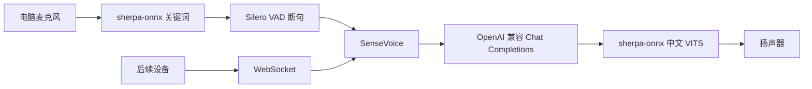

# vibe-voice

电脑麦克风上的中文语音助手。唤醒、断句、识别、对话和语音合成都在这台机器上跑。后面如果接小爱音箱或小智开发板，设备只负责唤醒和收音，对话仍然走这里的 WebSocket。本仓库没有烧录任何硬件。

默认唤醒词是 **你好小助**。

## 架构



麦克风这条链路是半双工：合成语音在播放时，不会同时读麦克风，所以电脑端不做回声消除。小智一类设备自己带唤醒和回声消除，本服务只收它唤醒之后的音频。

内部统一用 16 kHz、单声道、float32。设备如果送来别的采样率，会先做线性重采样再识别。

## 安装

需要 Python 3.11 及以上。Linux 上麦克风还要 PortAudio；要接小智的 Opus 音频时再装 libopus。

```bash
python3 -m venv .venv
source .venv/bin/activate
pip install -e ".[dev,device]"
# Debian / Ubuntu
sudo apt install libportaudio2 libopus0
```

`pip install` 不会下载语音模型。测试也不会下载。

## 下载模型

```bash
vibe-voice download
```

文件放在 `models/`（已被 git 忽略）。用的是 sherpa-onnx 发布的这些包：

| 作用 | 目录或文件 | 说明 |
| --- | --- | --- |
| 唤醒 | `models/sherpa-onnx-kws-zipformer-wenetspeech-3.3M-2024-01-01/` | 中文 zipformer 关键词，ppinyin |
| 识别 | `models/sherpa-onnx-sense-voice-zh-en-ja-ko-yue-int8-2024-07-17/` | SenseVoice int8，中英日韩粤 |
| 断句 | `models/silero_vad.onnx` | Silero VAD |
| 合成 | `models/sherpa-onnx-vits-zh-ll/` | 中文 VITS，多说话人 |

只下某一块：`vibe-voice download --only vad,kws,stt`。`--skip-tts` 跳过合成模型。TTS 文件不齐时，识别和对话照常进行，只是没有声音。

这些压缩包是一百 MB 这一量级，不是数 GB，但仍然只在这条命令里下载。

## 配置

复制 `config.example.toml` 为 `config.toml`，或复制 `.env.example` 为 `.env`。环境变量盖过配置文件；`.env` 只填当前环境里还没有的变量。

大模型只走 OpenAI 兼容的 `POST {OPENAI_BASE_URL}/chat/completions`，不绑任何厂商 SDK。云端接口、Ollama、vLLM 都是改地址、密钥和模型名。

```bash
# 云端
export OPENAI_BASE_URL=https://api.openai.com/v1
export OPENAI_API_KEY=sk-...
export OPENAI_MODEL=gpt-4o-mini

# Ollama
export OPENAI_BASE_URL=http://127.0.0.1:11434/v1
export OPENAI_API_KEY=ollama
export OPENAI_MODEL=qwen2.5:7b

# vLLM
export OPENAI_BASE_URL=http://127.0.0.1:8000/v1
export OPENAI_API_KEY=local
export OPENAI_MODEL=Qwen/Qwen2.5-7B-Instruct
```

密钥为空时不发送 `Authorization`。本地服务如果强制要这个头，随便填一个非空字符串即可。

其它常用变量：

| 变量 | 含义 | 默认 |
| --- | --- | --- |
| `VIBE_KEYWORDS_FILE` | 唤醒词文件 | 包内 `vibe_voice/keywords.txt`，若当前目录有 `keywords.txt` 则用那个 |
| `VIBE_MODELS_DIR` | 模型目录 | `./models` |
| `VIBE_WS_HOST` / `VIBE_WS_PORT` | WebSocket | `0.0.0.0:8765` |
| `VIBE_WS_TOKEN` | 设备令牌。留空则不校验 | 空 |
| `VIBE_TTS_SID` | 中文 VITS 说话人 | `2` |
| `VIBE_TTS_SPEED` | 语速 | `1.0` |
| `VIBE_VAD_MIN_SILENCE_MS` | 停顿多久算说完 | `600` |
| `VIBE_VAD_MIN_SPEECH_MS` | 短于此时长的声音丢掉 | `250` |
| `VIBE_WAKE_SUPPRESS_MS` | 唤醒后丢掉的尾音 | `300` |
| `VIBE_WAKE_TIMEOUT_MS` | 唤醒后多久不说话就回到等待 | `8000` |
| `VIBE_STT_LANGUAGE` | SenseVoice 语言 | `zh`（也可用 `auto`） |
| `VIBE_MIC_DEVICE` / `VIBE_SPEAKER_DEVICE` | sounddevice 设备号 | 系统默认 |
| `VIBE_SYSTEM_PROMPT` | 系统提示，要求短口语 | 内置「小助」提示 |

`vibe-voice check` 会列出模型是否已就位，并打码显示密钥（只写「已设置」或「未设置」）。

## 运行

在仓库目录里：

```bash
vibe-voice download
vibe-voice check
vibe-voice            # 等价于 vibe-voice mic
```

对着麦克风说「你好小助」，停顿一下，再说你的问题。终端会打印识别结果和回复。TTS 模型在的话，接着播放语音。`Ctrl+C` 结束。

只开 WebSocket、不打开麦克风：

```bash
vibe-voice serve
# 或者
vibe-voice --websocket-only --host 0.0.0.0 --port 8765
```

两条路径是同一个会话处理器：

- `ws://<主机>:8765/v1/voice`：下面的自有协议，给 open-xiaoai 或其它程序转发音频
- `ws://<主机>:8765/xiaozhi`：小智固件的对话协议

`VIBE_WS_TOKEN` 非空时，握手要带 `Authorization: Bearer <token>`。留空适合只在本机试用；不要把没有令牌的端口暴露到公网。

## 更换唤醒词

默认文件是 `vibe_voice/keywords.txt`：

```text
n ǐ h ǎo x iǎo zh ù :1.5 #0.25 @你好小助
```

这是 sherpa-onnx 的 ppinyin：声母和带调韵母用空格分开。`:1.5` 是加速分（越大越容易留在搜索里），`#0.25` 是触发阈值（越大越不容易误触发）。冒号和 `#` 后面不要加空格。`@` 后面是原文，不能有空格。以 `# ` 开头的行是注释，真正交给模型的是去掉注释后的内容。

要换成别的词，先写 `keywords.raw.txt`：

```text
你好小助 :1.5 #0.25 @你好小助
```

装好 sherpa-onnx 并下载关键词模型之后：

```bash
sherpa-onnx-cli text2token \
  --text keywords.raw.txt \
  --tokens models/sherpa-onnx-kws-zipformer-wenetspeech-3.3M-2024-01-01/tokens.txt \
  --tokens-type ppinyin \
  --output keywords.txt
export VIBE_KEYWORDS_FILE="$PWD/keywords.txt"
vibe-voice keywords
```

不同版本的命令行参数可能是 `--text/--output`，也可能是位置参数。以 `sherpa-onnx-cli text2token --help` 为准。ppinyin 必须带 `@原文`。

`VIBE_KWS_SCORE` 和 `VIBE_KWS_THRESHOLD` 是词表里没写 `:加速分` 或 `#阈值` 时的默认值。词表里写了的话，以那一行自己的数为准。

## WebSocket 协议

### 自有协议（`/v1/voice`）

适合以后在 open-xiaoai 里把唤醒后的录音转过来。文本帧是 JSON，二进制帧是音频。

1. `{"type":"session.start","source":"open-xiaoai","audio":{"format":"pcm","sample_rate":16000,"channels":1,"encoding":"int16"}}`
2. `{"type":"wake","keyword":"你好小助","source":"open-xiaoai"}`
3. 二进制：16-bit 小端 PCM，或 WAV（`format` 为 `wav` 时整段发送），或 Opus 包（`format` 为 `opus`，16 kHz，单声道，60 ms 一包）
4. `{"type":"audio.end"}`

`endpoint` 设为 `"vad"` 时，服务端用 Silero 判断说完，可以不发 `audio.end`。没有 VAD 模型时会提示你改发结束消息。

服务端依次返回：

- `session.ready`
- `wake.ack`
- `stt.final`：识别文本
- `llm.final`：回复文本
- `tts.start`（里面有采样率和 `encoding: int16`）、若干二进制 PCM、`tts.end`
- 没有 TTS 模型时是 `tts.unavailable`，文本仍然在 `llm.final` 里

`session.stop` 清空这路连接上的对话历史。`abort` 丢掉还没结束的录音。

### 小智协议（`/xiaozhi`）

对齐 [xiaozhi-esp32 的 WebSocket 对话](https://github.com/78/xiaozhi-esp32/blob/main/docs/websocket.md)。设备自己做唤醒和回声消除，连上之后：

1. 发送 `hello`（`transport` 为 `websocket`，`audio_params.format` 一般为 `opus`）。
2. 本服务回复 `hello`，带 `session_id` 和 `transport: "websocket"`。下行 Opus 是 16 kHz、单声道、60 ms。
3. `listen` 且 `state` 为 `detect` 时带上设备端唤醒词；`state` 为 `start` 后开始收二进制音频；`mode` 为 `auto` 或 `realtime` 时用 Silero 断句，`manual` 则等到 `state` 为 `stop`。
4. 本服务回 `stt`、`llm`（表情，固定中性）、`tts` 的 `start` / `sentence_start` / `stop`，中间是 Opus 二进制。
5. `abort` 会丢掉当前录音并回 `tts stop`。
6. `type: mcp` 只回答 `initialize`、`tools/list` 和 `ping`。没有实现设备工具调用。

`hello.version` 为 1 时二进制是裸 Opus。为 2 或 3 时按固件的 `BinaryProtocol2` / `BinaryProtocol3` 拆包（大端，和小智里的 `htons` / `htonl` 一致；长度对得上的小端帧也会收）。

没有 libopus / `opuslib` 时，小智这条链路不能编解码。电脑麦克风和 PCM、WAV 不受影响。安装：`sudo apt install libopus0` 然后 `pip install -e ".[device]"`。

## 硬件以后再接

下面两件事都还没做：没有刷机，也没有在真机上跑过。这里只有服务端，设备连上来之后才能收发音频。

### 小爱音箱 Pro（LX06）或小爱音箱（OH2P）

用 [open-xiaoai](https://github.com/idootop/open-xiaoai)。音箱刷机之后，唤醒可以继续放在音箱上（它的 [KWS 示例](https://github.com/idootop/open-xiaoai/blob/main/examples/kws/README.md) 就是 sherpa-onnx 拼音词表，词写成「你好小助」）。唤醒之后，把 16 kHz 单声道 PCM 发到 `ws://<这台机器>:8765/v1/voice`，顺序是 `session.start`（`source` 填 `open-xiaoai`）、`wake`、二进制 PCM、`audio.end`。`tts.start` 和 `tts.end` 之间的 PCM 交给音箱播放。

### ESP32-S3-BOX-3，或 ReSpeaker XVF3800 刷小智

用 [xiaozhi-esp32](https://github.com/78/xiaozhi-esp32)。唤醒和回声消除留在板上（自定义词用 MultiNet 拼音，不要在本服务再做一次设备端唤醒）。固件里的对话 WebSocket 指到 `ws://<这台机器>:8765/xiaozhi`。请求头仍按固件原来的 `Authorization`、`Protocol-Version`、`Device-Id`、`Client-Id` 发送。令牌和 `VIBE_WS_TOKEN` 保持一致。

## 测试

```bash
python -m pytest
```

覆盖关键词文件、大模型请求的组装（不访问网络）、静音断句、WebSocket 会话（含一条本机回环）。不下载模型，也不打开麦克风。

## 限制

- 模型要自己执行 `vibe-voice download`。没下之前，`vibe-voice` 会退出并告诉你缺什么。
- 中文 TTS 用的是 sherpa-onnx 的 `sherpa-onnx-vits-zh-ll`，不是单独训练的音色。默认说话人 ID 是 **2**（官方示例里的 `--sid=2`）。换音色改 `VIBE_TTS_SID`。模型还没下载时，只返回文字。
- 电脑麦克风没有回声消除，播放时不听麦。
- 小智的 MCP 工具调用没有实现，只把语音会话跑通。
- LX06、OH2P、ESP32-S3-BOX-3、ReSpeaker XVF3800 都还没接上，固件也不在这个仓库里。
